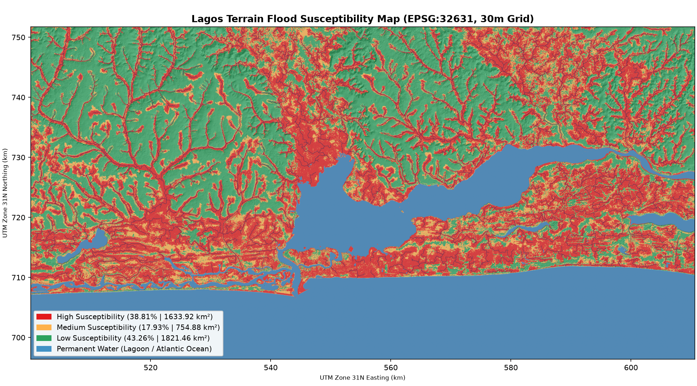
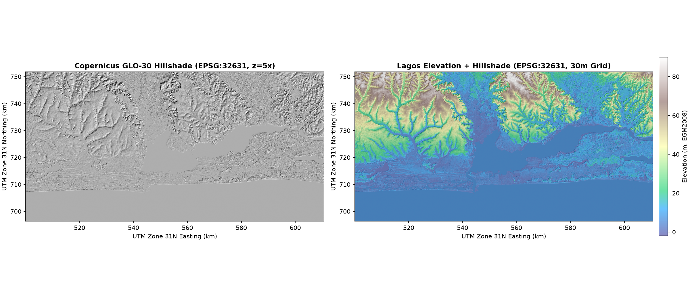
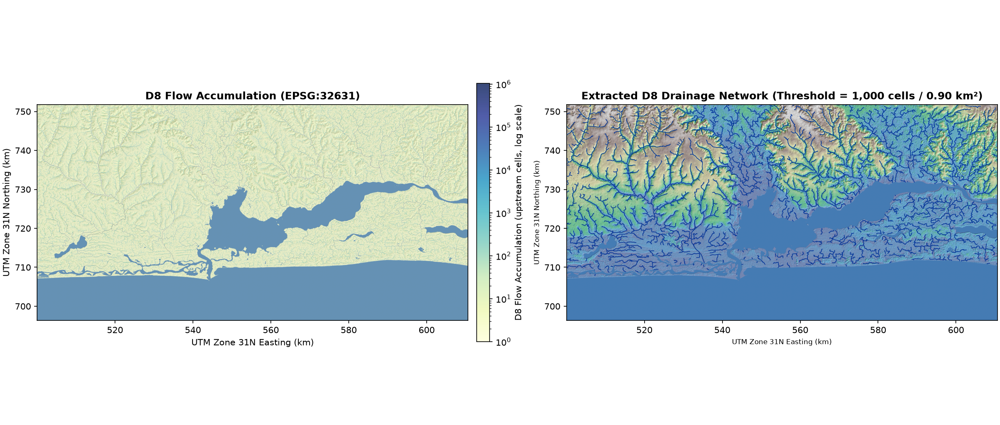
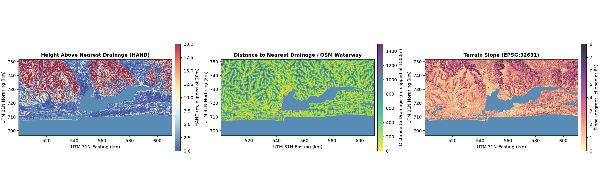

# Lagos Flood Susceptibility Map

A Python, GIS, and Django prototype that maps terrain-driven flood susceptibility across Lagos, Nigeria (`3.0°E–4.0°E, 6.3°N–6.8°N`) at 30-meter resolution.

This tool estimates **flood susceptibility** (where surface runoff collects based on topography and drainage proximity). It is **not** a weather-driven or real-time flood forecast.



---

## Pipeline Visual Outputs

| Milestone 1: Hillshade & Elevation | Milestone 2: D8 Flow & Stream Network |
| :---: | :---: |
|  |  |

### Milestone 3: HAND, Distance to Drainage, and Terrain Slope


---

## Method in Plain Language

All distance, slope, and hydrological calculations run in **`EPSG:32631` (WGS 84 / UTM Zone 31N)** so that horizontal coordinates (`X, Y`) and vertical elevation (`Z`) share metric units (meters). Geographic coordinates (`EPSG:4326`) are used only for downloading source data and displaying overlays on the web map.

### 1. DEM Mosaic, Clip, and Metric Reprojection (`pipeline/step1_dem.py`)
- Downloads two 1°×1° Copernicus GLO-30 Digital Elevation Model (DEM) tiles (`N06_00_E003_00` and `N06_00_E004_00`) from the public AWS S3 bucket.
- Merges the tiles with a 0.02° margin before warping to `EPSG:32631` at a `30.0 m × 30.0 m` grid using bilinear resampling.
- **Why**: Warping from a padded mosaic prevents triangular `NoData` edge slivers caused by UTM meridian convergence, and bilinear resampling prevents stair-step contour artifacts on flat coastal terrain.

### 2. Hydrological Conditioning and D8 Drainage Network (`pipeline/step2_hydrology.py`)
- Downloads the Copernicus Water Body Mask (`WBM`) and masks interior Atlantic Ocean and Lagos Lagoon pixels to `NoData`, leaving a 1-pixel shoreline ring at `0.0 m` as the terminal outlet for coastal catchments.
- Fills artificial surface pits (`fill_depressions` with flat fixing) so simulated water flows continuously downhill.
- Computes D8 flow direction (`d8_pointer`) and D8 flow accumulation (`d8_flow_accumulation`), then extracts stream channels where upstream contributing area reaches `FLOW_ACCUM_THRESHOLD_CELLS = 1000` cells (`0.90 km²`).

### 3. Height Above Nearest Drainage (HAND), Channel Proximity, and Slope (`pipeline/step3_hand.py`)
- Downloads OpenStreetMap waterways (`river`, `canal`, `stream`, `drain`, `ditch`) via the Overpass API and merges them with the D8 streams and shoreline outlets.
- Computes **HAND** (`hand_utm31n.tif`): the vertical elevation (in meters) of each land cell above the nearest drainage channel into which it flows.
- Computes **Euclidean distance to nearest drainage** (`dist_to_drainage_utm31n.tif` in meters) and **terrain slope** (`slope_deg_utm31n.tif` in degrees) in `EPSG:32631`.

### 4. Weighted Susceptibility Classification (`pipeline/step4_classify.py` & `pipeline/config.py`)
All thresholds and weights live in `pipeline/config.py`:

| Factor | Weight | Score 3 (High) | Score 2 (Medium) | Score 1 (Low) |
| :--- | :---: | :---: | :---: | :---: |
| **HAND (Primary)** | `0.60` | `<= 2.0 m` | `2.0 – 5.0 m` | `> 5.0 m` |
| **Distance to Drainage** | `0.25` | `<= 300 m` | `300 – 600 m` | `> 600 m` |
| **Terrain Slope** | `0.15` | `<= 1.5°` | `1.5° – 3.0°` | `> 3.0°` |

The composite score (`0.60 * HAND + 0.25 * Distance + 0.15 * Slope`) classifies every land cell into:
- **High (`3`)**: `score >= 2.40` (38.81% of Lagos land area, `1,633.92 km²`)
- **Medium (`2`)**: `1.75 <= score < 2.40` (17.93% of Lagos land area, `754.88 km²`)
- **Low (`1`)**: `score < 1.75` (43.26% of Lagos land area, `1,821.46 km²`)
- **Water / NoData (`0`)**: Permanent ocean and lagoon cells (`1,918.63 km²`)

### 5. Web Map and Point Query API (`mapapp/views.py`)
- Single-page Leaflet interface with OpenStreetMap basemap, transparent RGBA risk overlay (`risk_overlay_wgs84.png`), opacity slider, D8 stream network toggle, and legend.
- Clicking any point calls `/api/point/?lat=..&lon=..`, which converts `(lat, lon)` to `EPSG:32631` meters, reads a `1×1` pixel window from the rasters, and returns JSON with `elevation`, `hand`, `distance_to_drainage`, `slope_deg`, and `risk_class`. Out-of-bounds and water cells return structured status messages.

### 6. Benchmark Validation (`pipeline/step6_validate.py`)
- Evaluates 10 flood-prone locations documented in NIHSA, LASEMA, and peer-reviewed Lagos flood studies (`data/validation_points.csv`).
- **Result**: 9 of 10 locations (**90.0%**) fall in **High** (80.0%) or **Medium** (10.0%) susceptibility classes.

---

## Data Sources and Licences

| Dataset | Source | Access | Licence |
| :--- | :--- | :--- | :--- |
| **Copernicus GLO-30 DEM & WBM (30m)** | European Space Agency (ESA) / Sinergise AWS Open Data (`s3://copernicus-dem-30m`) | Public HTTPS, no API key | Copernicus DEM Licence (free and open access for any use, attribution required) |
| **OpenStreetMap Waterways & Basemap** | OpenStreetMap contributors via Overpass API (`osmnx`) and OSM tile servers | Public API, no API key | Open Database Licence (ODbL 1.0) |
| **Validation Locations** | NIHSA *Annual Flood Outlook*, LASEMA reports, Adelekan (2010), Nkwunonwo et al. (2016) | Included in `data/validation_points.csv` | Public scientific and agency literature |

---

## How to Run It

### 1. Create the Virtual Environment and Install Dependencies
On Ubuntu 24.04 (Python 3.12), `rasterio==1.5.2` and `pyogrio==0.13.0` install pre-built wheels bundling GDAL 3.12.2:

```bash
python3 -m venv .venv
.venv/bin/pip install -r requirements.txt
```

### 2. Run the GIS Pipeline
Every script caches downloads in `data/raw/` and skips completed outputs in `data/processed/` and `data/outputs/` unless `--force` is passed:

```bash
# Run all steps in sequence:
.venv/bin/python -m pipeline.run_all

# Or run individual milestones:
.venv/bin/python -m pipeline.step1_dem
.venv/bin/python -m pipeline.step2_hydrology
.venv/bin/python -m pipeline.step3_hand
.venv/bin/python -m pipeline.step4_classify
.venv/bin/python -m pipeline.step6_validate --csv data/validation_points.csv
```

### 3. Start the Django Web Application
```bash
.venv/bin/python manage.py runserver 127.0.0.1:8000
```
Open `http://127.0.0.1:8000/` in a browser, or query the API directly:
```bash
curl "http://127.0.0.1:8000/api/point/?lat=6.5880&lon=3.4020"
```

---

## LIMITATIONS

1. **DEM vertical error is comparable to Lagos' low coastal relief**:
   Copernicus GLO-30 has a 30-meter horizontal pixel size and an absolute vertical accuracy of roughly 2 to 4 meters. Because it is a Digital Surface Model (DSM) rather than a bare-earth LiDAR Digital Terrain Model (DTM), dense building roofs and tree canopies artificially raise elevation values in built-up mainland wards (such as parts of Alimosho and Mushin). In coastal Lagos—where a 1-to-2-meter elevation difference separates floodplains from dry ground—this vertical error and canopy/roof bias can misclassify localized urban depressions.
2. **HAND models gravity-driven rainfall runoff, not tidal or lagoon flooding**:
   Height Above Nearest Drainage measures vertical clearance above the local receiving channel assuming gravity-driven overland drainage. It does **not** simulate astronomical high tides, Atlantic storm surge, coastal erosion, wind setup across Lagos Lagoon, or hydraulic backwater locking (where high water levels in Lagos Lagoon prevent mainland drainage canals from discharging).
3. **OpenStreetMap drainage is incomplete and lacks channel capacity data**:
   While major rivers and primary canals (such as System 1–6 channels) appear in OpenStreetMap, most secondary street gutters, tertiary collector drains, and culverts across Lagos are unmapped. Furthermore, the GIS model has no information on channel depth, cross-sectional capacity, siltation, or solid-waste blockages that frequently cause street flooding during convective storms.
4. **Not for engineering, insurance, or statutory land-use decisions**:
   This prototype is a screening and educational demonstration tool. It must **not** be used for civil engineering design, drainage sizing, property valuation, flood insurance underwriting, or emergency evacuation planning. Engineering decisions in Lagos require sub-meter bare-earth LiDAR surveys, channel bathymetry, rainfall intensity-duration-frequency (IDF) curves, and coupled 1D/2D hydrodynamic modeling.
